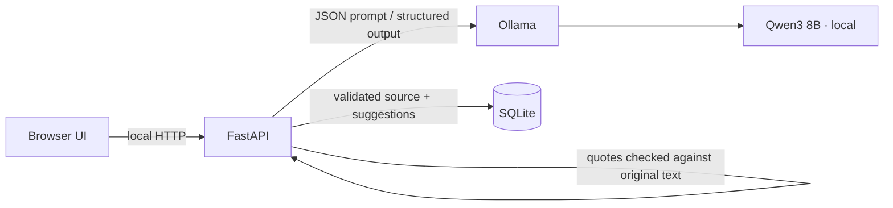
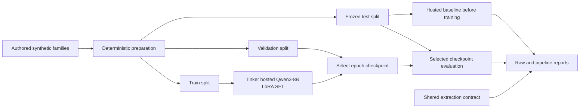

# Architecture

The Next.js client manages import, review, approval and drafts. FastAPI coordinates local Ollama inference and persists source documents, commitments and drafts in SQLite. Model-proposed quote strings are accepted only if they are literal substrings of the supplied source. The UI labels AI suggestions and requires explicit human approval before a follow-up can be drafted. Draft content is never sent.

The initial schema stores `SourceDocument`, paragraph-level `SourceFragment` records with source character offsets, `Commitment`, multiple `Evidence` quotes per grouped exact duplicate, `Draft`, and `AuditEvent` rows for reviewer edits and status decisions. P1 work should add people/project entities, asynchronous processing jobs, sentence-embedding duplicate candidates, and richer timeline views.

The redesigned client separates typed commitment/date helpers, a checked API adapter, and the evidence/review card from the workspace view. It uses a left sidebar and a keyboard-accessible mobile drawer, a vertical import editor, a confirmed-item timeline, an editable draft workspace and source-specific deletion controls. Importing clears the previous source timestamp. The client distinguishes valid calendar deadlines from unresolved text before counting past-due items. Details and verification are recorded in `docs/UI_REDESIGN.md`.

## Optional Tinker experiment boundary

`app/extraction_contract.py` now holds the existing schema, exact prompt, lexical gate and date resolver. `app/main.py` imports those definitions; Ollama parameters, SQLite persistence, API-level literal-quote checks and human approval remain unchanged. Importing the contract does not initialize the application database.

The optional `backend/tinker_lab` CLI sends only authored synthetic examples to Tinker. It saves configuration, rates, source/environment provenance, per-step logs, state/sampler paths, raw responses and session-filtered billing evidence. Held-out results do not select a checkpoint. The previous evaluation is development-only for this experiment.

The app defaults to Ollama. Optional `EXTRACTION_PROVIDER=tinker` uses `app/tinker_runtime.py` only with a finalized `TINKER_VERIFIED_RUN`. The guard checks dataset/checkpoint provenance, complete outputs and no held-out regression in F1, owner accuracy or date accuracy. Remote imports require explicit per-source consent, enforced in both UI and API, and cloud mode changes the privacy labels. API-level quote validation, approval, drafting and source deletion remain shared. A remote sampler does not establish Ollama adapter compatibility. See [the experiment protocol and current limitations](TINKER_EXPERIMENT.md) and [comparison status](TINKER_COMPARISON.md).

The October 25 checkpoint fails that quality guard because owner/date accuracy regressed. `TINKER_SYNTHETIC_PREVIEW=true` permits a separately labelled research demonstration while keeping provenance/technical checks and consent. Its API accepts only exact source text from the frozen train/validation/test/demo artifacts; unseen text is rejected before inference and the transaction rolls back. This flag does not enable general-note use. The demonstration uses an isolated SQLite database, and the root `.env` does not select the remote provider.
