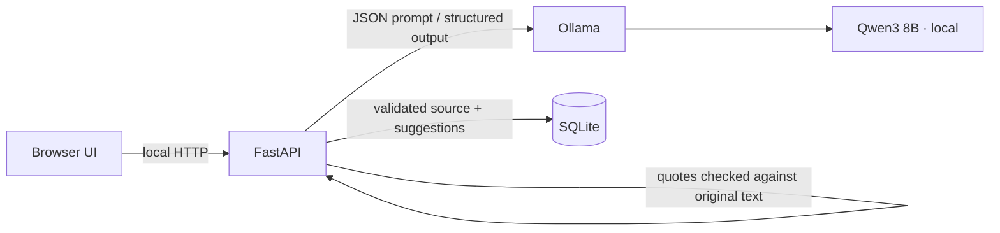

# Architecture

The Next.js client manages import, review, approval and drafts. FastAPI coordinates local Ollama inference and persists source documents, commitments and drafts in SQLite. Model-proposed quote strings are accepted only if they are literal substrings of the supplied source. The UI labels AI suggestions and requires explicit human approval before a follow-up can be drafted. Draft content is never sent.

The initial schema stores `SourceDocument`, paragraph-level `SourceFragment` records with source character offsets, `Commitment`, multiple `Evidence` quotes per grouped exact duplicate, `Draft`, and `AuditEvent` rows for reviewer edits and status decisions. P1 work should add people/project entities, asynchronous processing jobs, sentence-embedding duplicate candidates, and richer timeline views.

The redesigned client separates typed commitment/date helpers, a checked API adapter, and the evidence/review card from the workspace view. It uses a left sidebar and a keyboard-accessible mobile drawer, a vertical import editor, a confirmed-item timeline, an editable draft workspace and source-specific deletion controls. Importing clears the previous source timestamp. The client distinguishes valid calendar deadlines from unresolved text before counting past-due items. Details and verification are recorded in `docs/UI_REDESIGN.md`.
