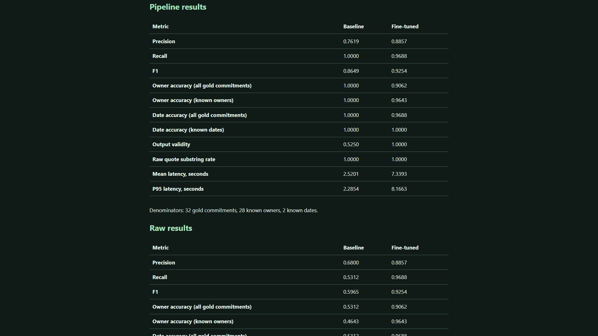
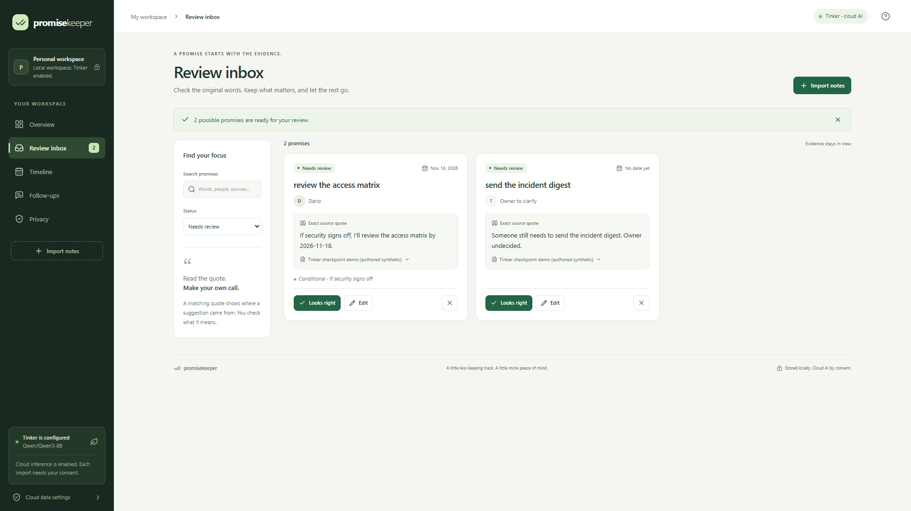

> Unpublished addendum for review, targeting Best Use of Tinker. The experiment has run; eligibility is not asserted. This draft does not replace the existing published article. Repository-relative media links must be replaced with approved public asset links before publication. The new video is local; no new YouTube URL exists.

PromiseKeeper already extracts possible promises from conversations with local Qwen3 8B through Ollama. Each suggestion keeps its exact source quote. A person reviews and approves it before preparing an editable follow-up draft. The app never sends that message.

I wanted to test whether supervised fine-tuning could improve that extraction task. Adding a cloud dependency would not answer the question, so I ran an actual baseline, trained a Qwen3-8B adapter with Thinking Machines' Tinker, and measured the selected checkpoint on the same held-out inputs.

The result was mixed: fewer false promises and cleaner structured output, alongside worse owner accuracy and slower observed sampling. That is why the existing local extractor remains the default.

## The experiment

The data contains 80 training, 20 validation and 40 held-out authored synthetic conversations. It covers explicit promises, implicit responsibility, conditions, refusals, completed work, hypotheticals, unresolved owners, deadlines, multiple commitments and speaker attribution. Wording families, names and task domains are separated across splits. The app's previous 55-case development corpus was preserved and was not reused as this experiment's independent benchmark.

The baseline and fine-tuned model both use hosted `Qwen/Qwen3-8B`, the same prompt and the same held-out inputs. This avoids treating a previous quantized Ollama score as an equivalent cloud baseline. All baseline outputs were collected before training.

Tinker ran six epochs of rank-32 LoRA supervised fine-tuning with assistant-only loss, learning rate 0.0002, batch size eight and seed 20261025. The run recorded 60 batches and 112,578 training tokens. State and sampler checkpoints were saved each epoch. Validation selected epoch one, with earlier epochs winning complete ties. Test scores did not choose a checkpoint.

## What changed

The primary results include the application's existing defaults, evidence checks, date resolution and exact duplicate grouping:

| Metric on 40 held-out synthetic transcripts | Baseline | Fine-tuned |
| --- | ---: | ---: |
| True positives / false positives / misses | 32 / 10 / 0 | 31 / 4 / 1 |
| Precision | 0.7619 | 0.8857 |
| Recall | 1.0000 | 0.9688 |
| F1 | 0.8649 | 0.9254 |
| Owner accuracy, all 32 gold commitments | 100% | 90.63% |
| Date accuracy, all 32 gold commitments | 100% | 96.88% |
| Strict raw schema validity | 52.5% | 100% |
| Mean observed sample latency | 2.520 s | 7.339 s |

Known-date accuracy remained two out of two for both models. That denominator is too small for a general deadline claim. The date score above also counts null fields and misses. Latency includes remote waiting and network effects; it is not a controlled hardware benchmark.

One illustrative refusal exposes a useful improvement. Asked about a vendor packet, Amina replies: "Not this time. My answer is no." The baseline extracted that refusal as a possible commitment. The checkpoint returned `{"commitments": []}`. This example was selected after evaluation to illustrate fewer false positives; it is part of the same test set, not another benchmark.

The fixed messy handoff is less flattering. Both models missed "Leave the migration guide with me." Both extracted a conditional security review and an unassigned digest. The fine-tuned condition was more specific, but detection did not improve in that example. The report preserves both outputs.

## The limits belong with the scores

A scorer error surfaced in validation during the run: version one discarded an entire response if `action` was missing, while the existing Ollama adapter supplies a default. I repaired that parity issue for both models, preserved strict raw validity as a separate metric, and rescored saved responses. Validation still selected epoch one, without another held-out inference pass. The original code, outputs and correction remain available.

The matcher uses task nouns and evidence overlap, not full semantic entailment. These are small, correlated, synthetic families without an independent annotation audit. The existing lexical filter also mishandles conditional "provided"; the difficult positive examples remain in training rather than being removed to improve a score. Literal evidence proves where a suggestion came from, not that its interpretation is correct.

## Keeping review and privacy visible

The adapter works with the existing extraction contract, but its owner/date regressions fail the production quality guard. Ordinary activation is blocked. The separate recording uses a clearly labelled research preview that accepts only exact frozen synthetic examples, with explicit cloud consent for every import. General user notes cannot enter that preview.

The new local demo shows a fresh checkpoint request, a simulated review that keeps the security condition visible, approval and an editable follow-up. Nothing is sent. The connection was warmed before recording and scene holds support narration, so the edited video is not a speed measurement. Cloud privacy labels also explain that deleting a local source does not delete provider-side records.

## What it cost and what is preserved

Measured tokens at recorded public rates estimate $0.049534 for training and $0.013408 for recorded sampling: about $0.063 combined, excluding storage and separate live preview calls. The provider's session usage later reported the same gross estimate. That is not an invoice or verified credit deduction. Actual invoice cost remains unknown.

Configuration, split hashes, raw responses, per-case scores, losses, all six checkpoint identifiers, environment/source snapshots, the scoring repair and cost evidence are in the [experiment bundle](tinker/run-20261025/README.md). The [full report](TINKER_COMPARISON.md) and [demo verification](TINKER_DEMO.md) explain the evidence and limits. The existing published article and original demo are preserved.

Fine-tuning helped precision and formatting in this experiment. It also supplied concrete reasons to retain the local default and human approval. A future iteration needs fresh held-out data before testing further changes.
